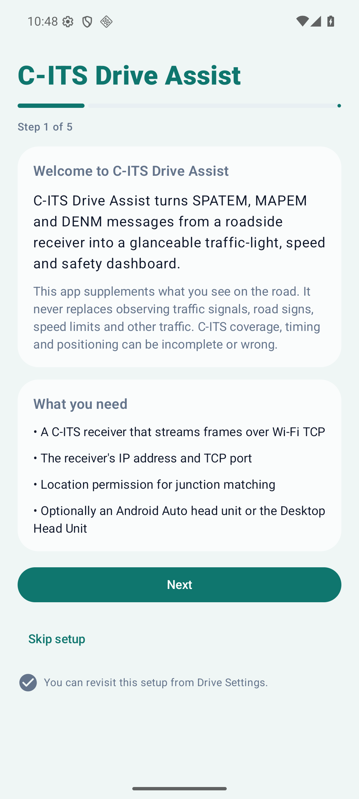
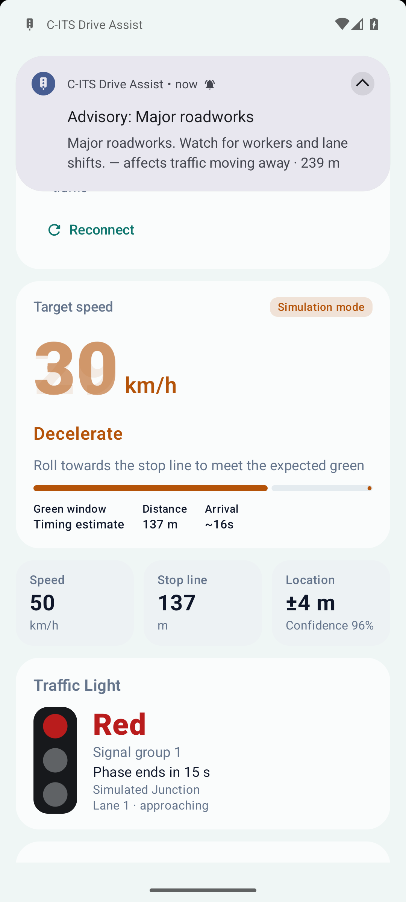
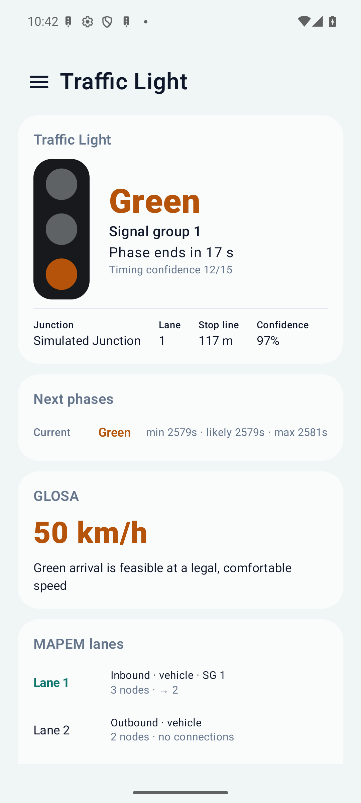

# C-ITS Drive Assist

**C-ITS Drive Assist** is the driving-assistance application built on the CITS-to-go repository. It
receives Cooperative ITS (C-ITS) messages from external hardware, decodes SPATEM, MAPEM and DENM,
matches the vehicle to the correct traffic-signal lane, calculates a safe GLOSA speed recommendation,
and presents relevant DENM hazards on a modern Android dashboard and on Android Auto.

The repository still contains the original CITS-to-go ESP32-C5 capture bridge, USB/BLE capture,
PCAP recording, MQTT forwarding, CAM/SREM transmission and map tooling. Those features remain
available in the **Capture** section of the app; the new **Drive** section is the primary interface.

> **Safety notice:** C-ITS and GLOSA information is supplementary. It may be delayed, incomplete or
> wrong. It never replaces observing the road, traffic signals, road signs and speed limits. Do not
> perform evasive manoeuvres based only on a DENM alert.

> **AI generation notice:** This repository is largely generated and modified with AI assistance.
> Review, test and audit it before relying on it, especially in or near live traffic.

<p align="center">
  
  
  
</p>

<p align="center">
  
  
  
</p>

---

## Acknowledgements and licence

CITS-to-go is heavily inspired by and derived from the **OpenTrafficMap** project, which did the
important groundwork on low-cost C-ITS reception, ESP32-C5 receiver firmware, packet forwarding and
public traffic-map tooling.

- OpenTrafficMap website: <https://opentrafficmap.org>
- OpenTrafficMap Codeberg organization: <https://codeberg.org/opentrafficmap>

This project is not an official OpenTrafficMap release. The upstream licence and attribution are
preserved in [LICENSE](LICENSE) and in the in-app About page.

---

## Feature overview

### Driving dashboard

- Hardware connection status, last error and reconnect state.
- Vehicle position, speed and accuracy.
- Nearest matched MAPEM intersection and inbound lane.
- Current SPATEM signal state, signal group and countdown.
- GLOSA target speed, advisory and green arrival window.
- Active DENM event count and the highest-priority alert.
- C-ITS data freshness, matched-lane confidence and message rate.
- Explicit **Simulation** badge when offline example data is active.

### C-ITS communication

- Configurable hardware IP address and TCP port (no hardcoded address).
- Connection timeout, automatic reconnect, bounded exponential backoff and status monitoring.
- Framing modes for common receivers: 4-byte big-endian length prefix (default), 2-byte length
  prefix, COBS (same as the CITS-to-go firmware) and newline-delimited hexadecimal frames.
- Correct stream reassembly: a TCP read is never treated as one message.
- Malformed, truncated and oversized frames are counted and skipped without killing the stream.
- Optional foreground service keeps reception and location active with the screen off.
- Wi-Fi/network callbacks trigger reconnection and connection-loss handling.

### Traffic lights and GLOSA

- SPATEM: intersection ID, revision, signal group, current/upcoming states, min/likely/max end
  times, confidence and message timestamps.
- MAPEM: intersection reference point, lane width, intersections, lane geometry, ingress/egress
  attributes, stop lines, lane connections, signal-group associations and regulatory speed limits.
- Position matching uses GPS coordinates, accuracy, speed and heading, then scores lane proximity,
  heading error, signal-group evidence and data freshness.
- If the lane or signal group cannot be identified confidently, no GLOSA recommendation is shown.
- GLOSA respects the road limit from MAPEM, the profile speed cap, comfortable acceleration and
  deceleration, timing uncertainty and data age. It never recommends speeding or aggressive
  acceleration to catch a green light.

### Safety alerts (DENM)

- ActionID-based event identity, repetition detection, updates, cancellation, negation and expiry.
- ETSI cause/subcause classification with three priorities: Critical, Advisory, Informational.
- Event distance, relative direction, relevance, age, remaining validity, information quality and
  confidence.
- Filters by priority and event category; configurable relevance distances and enabled categories.
- Bounded active set and durable event history in SQLite.
- Deduplicated notifications with cooldowns; repeated 1 Hz DENMs do not spam the driver.
- Optional tones per priority, Android audio focus, volume control, quiet mode and text-to-speech.

### Driver profiles and settings

- Create, edit, duplicate, select and delete profiles (the selected and last profile are protected;
  select another profile before deleting one).
- Each profile stores GLOSA comfort, acceleration/deceleration, speed cap, alert categories,
  relevance distances, audio preferences, units, large-text and keep-screen-on preferences.
- Versioned JSON storage with field-by-field migration defaults; corrupt documents fall back safely.
- Versioned application settings, onboarding state, simulation, location frequency/accuracy,
  stale-data threshold and history limit.
- Export/import of settings and profiles as a portable JSON document.

### Android Auto

- Official Android for Cars App Library (`androidx.car.app:app:1.7.0`), navigation category.
- `NavigationTemplate` while a junction or recommendation is active, with a glanceable message and a
  status action; `PaneTemplate` for the full status; `MessageTemplate` for a very close critical
  hazard.
- Car notifications for alerts use the supported `CarAppExtender`.
- No projection exploits, screen mirroring, custom layouts or undocumented APIs.
- The phone dashboard works independently of Android Auto and vice versa.

### Onboarding and diagnostics

- First-launch setup with safety disclaimer, hardware address, framing, connection test, location
  and notification permissions, profile selection and a final ready screen.
- Connection testing from the setup and connection screens.
- Raw diagnostics view with frame counts, MAPEM/SPATEM/DENM decode counts, malformed/unsupported
  frames, message rate, connection attempts/reconnects and a bounded recent-message list.
- Exportable diagnostics text (metadata only, no raw payloads).

---

## Architecture

```
                    ┌──────────────────────────────┐
  C-ITS hardware ──►│ TcpCitsClient + FrameDecoder  │
  (Wi-Fi TCP)       └──────────────┬───────────────┘
                                   │ reassembled frames
                                   ▼
                    ┌──────────────────────────────┐
                    │ DriveEngine                  │
                    │  ItsFrameExtractor           │
                    │  MapSpatDecoder / DenmDecoder│
                    │  IntersectionStateStore      │
                    │  IntersectionMatcher         │
                    │  GlosaEngine                 │
                    │  SafetyAlertManager          │
                    └──────┬───────────────┬───────┘
                           │ StateFlow     │ notifications
                 ┌─────────▼──────┐  ┌─────▼─────────────────┐
                 │ Phone Compose  │  │ DriveAssistService     │
                 │ dashboard/UI   │  │ foreground, location,  │
                 └────────────────┘  │ audio, notifications   │
                                     └─────┬─────────────────┘
                                           │ StateFlow
                                     ┌─────▼───────────────┐
                                     │ Android Auto screens │
                                     └─────────────────────┘
```

Key packages under `android-app/app/src/main/java/org/opentrafficmap/citstogo/`:

| Package | Responsibility |
| --- | --- |
| `drive/net` | TCP client, framing/reassembly, reconnect policy, connection tests |
| `drive/engine` | Application-scoped coordinator and `DriveSnapshot` |
| `drive/position` | Geographic maths and MAPEM lane/signal-group matching |
| `drive/glosa` | Pure, unit-tested GLOSA calculation |
| `drive/safety` | DENM normalisation, lifecycle, relevance, priority and dedup |
| `drive/profile` | Versioned driver-profile persistence |
| `drive/config` | Versioned settings and configuration export/import |
| `drive/history` | SQLite event history |
| `drive/audio` | Tones, TTS and audio focus |
| `drive/sim` | Offline simulation source |
| `drive/auto` | Android Auto Car App service and screens |
| `drive` (root) | `DriveAssistService`, foreground notification and lifecycle |
| `intersection` (existing) | Reused ASN.1/UPER MAPEM and SPATEM decoders |
| `denm` (existing) | Reused DENM decoder, extended with event speed/heading |
| `bridge` (existing) | USB/BLE capture, PCAP, MQTT and firmware flashing |

The UI is Jetpack Compose (Material 3), the existing project framework. Persistence uses
`SharedPreferences` + versioned JSON for profiles/settings and the platform SQLite helper for event
history. Room was not added because a single append-only history table does not justify the KSP
toolchain increase.

---

## Supported C-ITS messages and ASN.1 profiles

The decoders operate on unpacked (`UPER`, aligned as used by the existing implementation) ETSI ITS
PDUs:

| Message | ITS message ID | Typical BTP port | Standards |
| --- | --- | --- | --- |
| DENM | 1 | 2001 (BTP-B) | ETSI EN 302 637-3, CDD cause codes |
| SPATEM | 4 | 2004 | ETSI TS 103 301 (SPATEM), J2735/ETSI SignalPhaseAndTiming |
| MAPEM | 5 | 2003 | ETSI TS 103 301 (MAPEM), J2735/ETSI MapData |
| CAM (capture/map) | 2 | 2001 | ETSI EN 302 637-2 |

Frames are expected as IEEE 802.11/radiotap or GeoNetworking envelopes containing the
`aa:aa:03:00:00:00:89:47` LLC/SNAP header. Secured GeoNetworking (`NH = 2`, IEEE 1609.2
`unencryptedData`) is supported by locating the signed inner packet; security trailers are excluded
from the ASN.1 body. See `docs/DRIVE_ASSIST.md` for the exact decoder scope and the fields that are
retained.

The app does not invent causes or signal states: unknown DENM causes are retained with their raw
cause/subcause and shown as an "Other event"; unknown signal states produce no GLOSA.

---

## Hardware compatibility

Two kinds of hardware are supported:

1. **Network C-ITS receiver** — any device that streams captured 802.11/GeoNetworking frames over
   Wi-Fi TCP. Configure its IP and port. The receiver must use one of the framing modes listed above;
   4-byte big-endian length prefix is the default.
2. **CITS-to-go ESP32-C5 USB/BLE bridge** — the original capture path remains available under
   **Capture**. It provides USB serial/Bluetooth LE capture, PCAP, MQTT, CAM/SREM and map features.

Reception quality depends on the antenna, placement, local C-ITS deployment and the receiver's
firmware. No specific commercial hardware is required or hardcoded.

---

## Installation

### Download a release

1. Open the repository's **Releases** page on GitHub.
2. Download the APK for the release.
3. Allow installation from the file manager/browser if Android asks.
4. Install and open **C-ITS Drive Assist**.
5. Complete onboarding: enter the receiver IP/port, choose framing, test the connection, grant
   location/notification permissions and select a profile.

Signed releases are produced when the repository signing secrets are configured. Otherwise the
release workflow attaches an unsigned APK for personal testing; install it with `adb install` or sign
it with your own key.

### Build locally

Requirements: JDK 17, Android SDK platform 35 and build-tools 35.0.0, or the provided Nix shell
(`nix-shell android-app/shell.nix`).

```bash
cd android-app
export JAVA_HOME=/path/to/jdk17
export ANDROID_HOME=/path/to/Android/Sdk
./gradlew :app:assembleDebug
# APK: app/build/outputs/apk/debug/app-debug.apk
```

Unit tests and lint:

```bash
./gradlew :app:testDebugUnitTest
./gradlew :app:lintDebug
```

Release build without signing secrets:

```bash
./gradlew :app:assembleRelease
# app/build/outputs/apk/release/app-release-unsigned.apk
```

The repository's `scripts/build-release.sh` still produces the combined Android + firmware release
when `android-app/.env.release` and Nix are available.

---

## TCP configuration and framing

Open **C-ITS Connection** in the drawer.

| Setting | Meaning |
| --- | --- |
| Hardware IP address | IPv4/IPv6/hostname of the receiver. Leading `tcp://` and a trailing path are removed. |
| TCP port | Default `4711`; any 1–65535 value. |
| TCP framing | Length-prefixed (4/2-byte big-endian), COBS or hex lines. Match the receiver. |
| Connect automatically | Start the drive service when the app starts (after onboarding). |
| Keep running in background | Keep the foreground service when the task is removed. |
| Reconnect delay | Base delay for bounded exponential backoff (1–30 s, capped at 60 s with jitter). |
| Connection timeout | TCP connect timeout (2–30 s). |
| Location interval / accuracy | GPS update rate and power/accuracy trade-off. |

The **Test connection** button opens a one-shot socket, reports latency and bytes read, and closes
it again. The diagnostics view reports attempts, reconnects, bytes, frames and the last error.

There is no default hardware address. If none is configured, the dashboard says so and the service
keeps running with no link.

---

## Android Auto setup

The app uses the official Car App Library and declares
`androidx.car.app.category.NAVIGATION`. It does **not** provide turn-by-turn routing or a map on the
head unit; it provides glanceable C-ITS driving information and uses a supported
`NavigationTemplate` while a junction/recommendation is active. If a host requires a map surface for
navigation-category apps, the status remains available through the supported template and the phone
dashboard.

### Desktop Head Unit (recommended for testing)

1. Install Android Studio and the Android Auto Desktop Head Unit (DHU).
2. Enable developer mode in the Android Auto phone app (tap **Version** repeatedly).
3. On the phone, enable **Developer settings → Unknown sources** (required for sideloaded apps).
4. Connect the phone over USB, run `adb forward tcp:5277 tcp:5277`, then start the DHU.
5. Start the drive service in the app and open **C-ITS Drive Assist** on the head unit.

The manifest declares the official `androidx.car.app.NAVIGATION_TEMPLATES`,
`androidx.car.app.MAP_TEMPLATES` and `androidx.car.app.ACCESS_SURFACE` permissions required for the
navigation-category templates. The car screen keeps a stable `NavigationTemplate` while driving
rather than switching template types, and falls back to a valid `MessageTemplate` if a template
cannot be built. This avoids the host's "unknown error" path caused by missing navigation-template
permissions or repeated template-type changes.

Because the app is not distributed through Play, `DriveCarAppService` uses the documented
`HostValidator.ALLOW_ALL_HOSTS_VALIDATOR` testing validator. Host policy still applies: some vehicles
or head units refuse apps that Google has not approved. This is a host restriction, not a supported
API bypass.

### Manual test checklist

- The head unit shows connection status, speed, signal state, GLOSA advisory and the primary alert.
- A critical DENM within 250 m produces a message template or car notification.
- The phone dashboard continues to work while Android Auto is connected.
- Disconnecting/reconnecting the receiver updates the head unit within ~1 second.
- Switching driver profiles changes GLOSA/alert behaviour on both screens.

---

## Driver profiles

Profiles are found under **Driver Profiles**. The selected profile is loaded at startup and applies
immediately when changed. Each profile stores:

- GLOSA on/off, comfortable acceleration/deceleration, arrival strategy and maximum speed cap.
- Enabled DENM categories and critical/advisory/informational relevance distances.
- Notification, audio, speech, quiet mode, repeat-reminder and volume settings.
- Metric/imperial, large dashboard text, keep-screen-on and map-preview preferences.

The selected and last remaining profile cannot be deleted; select another profile first. Export the
configuration from **Drive Settings** before switching phones.

---

## GLOSA explanation

GLOSA (Green Light Optimal Speed Advisory) uses the matched lane's distance to the stop line and the
current SPATEM phase. For a green phase it calculates whether the stop line can be reached before the
conservative `minEndTime` at a speed within the road/profile limit and the comfortable acceleration
envelope. For a red phase it calculates a speed that arrives as the expected green begins; if that
would require crawling or hard braking, it recommends stopping instead.

The app never presents a recommendation as a guarantee:

- `minEndTime` is treated as the conservative transition time.
- A safety margin is subtracted from the remaining green.
- Timing confidence and the min/likely/max spread reduce the displayed confidence.
- Data older than the configured stale threshold, low lane confidence, missing timing or a lost
  receiver produces **no** numeric recommendation.
- If a critical hazard is ahead, GLOSA is suppressed so the hazard remains the primary information.

---

## DENM explanation

A DENM is identified by `(originatingStationId, sequenceNumber)`. Repetitions with the same
reference/detection time only refresh reception; newer detection/reference times update the event;
a termination cancels or negates it. Events expire with their validity duration. The app never treats
a repeated DENM as a brand-new event.

Cause and subcause labels come from ETSI CDD definitions already present in the upstream decoder.
Unknown causes are preserved and classified as `Other`. The app calculates distance, relative
direction, relevance to the driving direction, age, validity, information quality and confidence. It
does not suggest evasive manoeuvres.

---

## GitHub Actions

### CI

`.github/workflows/android-ci.yml` runs on pushes to `main`, pull requests and manual dispatch:

1. Checkout, JDK 17, Android SDK, Gradle cache.
2. Unit tests.
3. Android lint.
4. Debug APK.
5. Unsigned release APK (no secrets required).
6. Upload APKs and reports as artifacts.

### Release

`.github/workflows/android-release.yml` runs on `v*` tags and manual dispatch with a version input:

1. Checkout the requested revision and derive the version.
2. Test and lint; a failure stops the release.
3. Decode an optional keystore from secrets.
4. Build the signed release APK (or unsigned when no secrets exist) and an App Bundle.
5. Generate notes from git history.
6. Create a GitHub Release with predictable filenames and `SHA256SUMS.txt`.

Required repository secrets for signed releases:

| Secret | Meaning |
| --- | --- |
| `ANDROID_KEYSTORE_BASE64` | Base64 of the `.jks`/`.keystore` file |
| `ANDROID_KEYSTORE_PASSWORD` | Keystore password |
| `ANDROID_KEY_ALIAS` | Key alias |
| `ANDROID_KEY_PASSWORD` | Key password |

Never commit a keystore or passwords. `versionCode` defaults to the value in
`android-app/app/build.gradle`; increase it for every published release or pass the optional
`version_code` manual-dispatch input.

---

## Known limitations

- **Android Auto** cannot be exercised in a plain headless CI environment; the DHU/real-vehicle
  checklist above is required. Host policy may refuse sideloaded navigation-category apps.
- The TCP receiver protocol is not standardised. The app supports the documented framing modes; a
  receiver with a proprietary frame header must be adapted in `TcpFrameDecoder`.
- DENM à-la-carte root fields are normalised: lane position, impact reduction (vehicle height,
  lateral carrier positions, pillars, centre of mass, wheelbase, turning radius, front axle,
  occupants, mass), external temperature, roadworks (light bar/siren, closed lanes, restricted
  station types, speed limit, incident cause, recommended path, starting point, traffic flow rule,
  referenced DENMs), positioning solution and stationary-vehicle data (duration, cause, dangerous
  goods, occupants, vehicle identification, energy storage). Future extension additions are counted
  but not interpreted.
- MAPEM per-lane regulatory speed limits from node attributes are decoded and take precedence over
  the intersection-level limit for GLOSA; the driver-profile cap remains the upper bound.
- Position matching uses the phone GPS. Hardware-provided position is an interface-ready future
  extension, not yet wired to a specific receiver protocol.
- Captured field-capture/tshark validation tests are skipped when the optional PCAP fixtures or
  Wireshark CLI are unavailable; they still run when present.
- The app is intended for personal use initially. Public distribution requires host/category review,
  privacy review and legal review for the target jurisdiction.

---

## Troubleshooting

| Symptom | Checks |
| --- | --- |
| No connection | IP/port, receiver powered, same Wi-Fi, firewall, framing mode, diagnostics last error |
| Data arrives but nothing decodes | Receiver must send full 802.11/GeoNetworking frames, not just BTP payload bytes; check raw diagnostics |
| GLOSA missing | Location permission, fresh GPS fix, MAPEM/SPATEM received, lane matched with confidence, data not stale, GLOSA enabled in profile |
| Wrong traffic light | Vehicle may be on an adjacent lane; check MAPEM Debug matched lane and signal group. The app intentionally shows nothing when unsure |
| Alerts do not notify | Profile category enabled, notification permission, relevance distance, event ahead/behind filter, quiet mode |
| Android Auto does not show the app | Developer mode + unknown sources, DHU connected, host policy; see manual checklist |
| Android Auto shows "unknown error occurred" | Reinstall the latest build (navigation-template permissions were added), keep the phone app/service updated, and capture `adb logcat -s DriveCarApp` plus the Android Auto/Play Services log. The car screen now falls back to a valid message template instead of crashing. |
| Background stops | Disable battery optimisation for the app, keep the foreground notification, enable background operation |
| USB capture issues | See the original CITS-to-go troubleshooting section below |

### Original USB/BLE capture notes

The Android app can still read the USB serial stream from the ESP32-C5, decode the firmware's COBS
frames, save PCAP, forward MQTT packets and generate CAM/SREM messages. If Android asks for USB
permission repeatedly, reconnect the XIAO, use a data-capable cable, and reopen the app after
granting permission. MQTT `broken pipe` is treated as a reconnectable failure with a retry spool.

---

## Safety, privacy and legal notes

- C-ITS and GLOSA are **supplementary** and must never replace watching the road, traffic signals,
  road signs or applicable speed limits.
- Do not use DENM information as the sole basis for an evasive manoeuvre.
- Captures and diagnostics can contain location/operational data. Treat PCAPs and exported logs as
  potentially sensitive. The diagnostics export intentionally contains metadata, not raw payloads.
- Transmitting in the 5.9 GHz ITS band is regulated. Only transmit in a controlled, shielded or
  otherwise authorised environment with a valid station identity. Never inject deceptive traffic
  into a live road environment.
- Check local rules before capturing, storing, forwarding or publishing C-ITS data.
